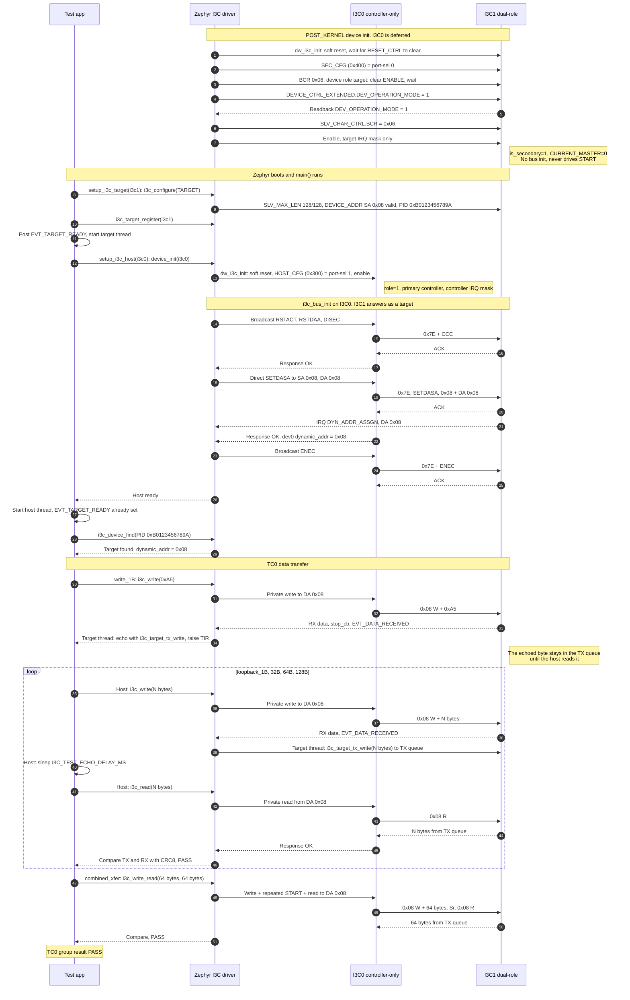

# MEC175x MECC card: I3C loopback, expected sequence

- Board: `mec_assy6941/mec1753_qsz`
- I3C0 = `i3c@40010800` (HOST0, controller-only), port-sel 1 (`HOST_CFG` at 0x300)
- I3C1 = `i3c@40010000` (SEC0, dual-role), port-sel 0 (`SEC_CFG` at 0x400), `bcr = <0x06>`
- Test case `CONFIG_I3C_TEST_CASE=0` (data transfer), target in echo mode

Assumptions:

- `DEV_OPERATION_MODE` on I3C1 accepts the target mode (not achieved yet, see the
  failure after the `bcr` property)
- `&i3c0` carries `zephyr,deferred-init`, so bus init (SETDASA 0x08) runs from
  `setup_i3c_host()` after `main()` has given I3C1 its static address. The current
  loopback overlay does not set it.

