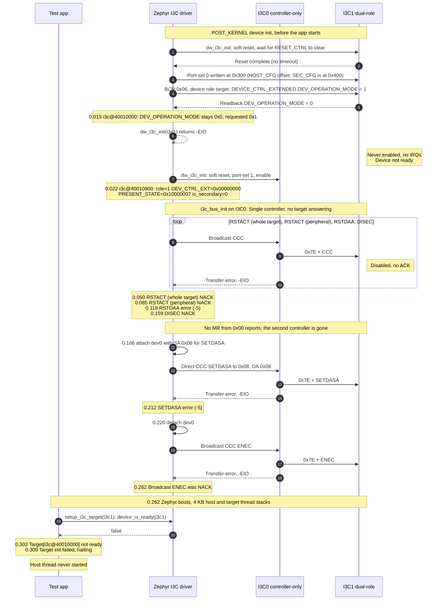

# MEC175x MECC card: I3C loopback, failure with the bcr property

- Board: `mec_assy6941/mec1753_qsz`
- Source log: `teraterm_loopback_v4.log`
- Build: `bcr = <0x06>` on `&i3c1`, driver writes `DEV_OPERATION_MODE` before enable,
  waits for the soft reset to complete, 4 KB thread stacks
- Not in this build: clearing `ENABLE` before the mode write, `SEC_CFG` (0x400)
  port-select offset
- I3C0 = `i3c@40010800` (HOST0, controller-only), port-sel 1
- I3C1 = `i3c@40010000` (SEC0, dual-role), port-sel 0

