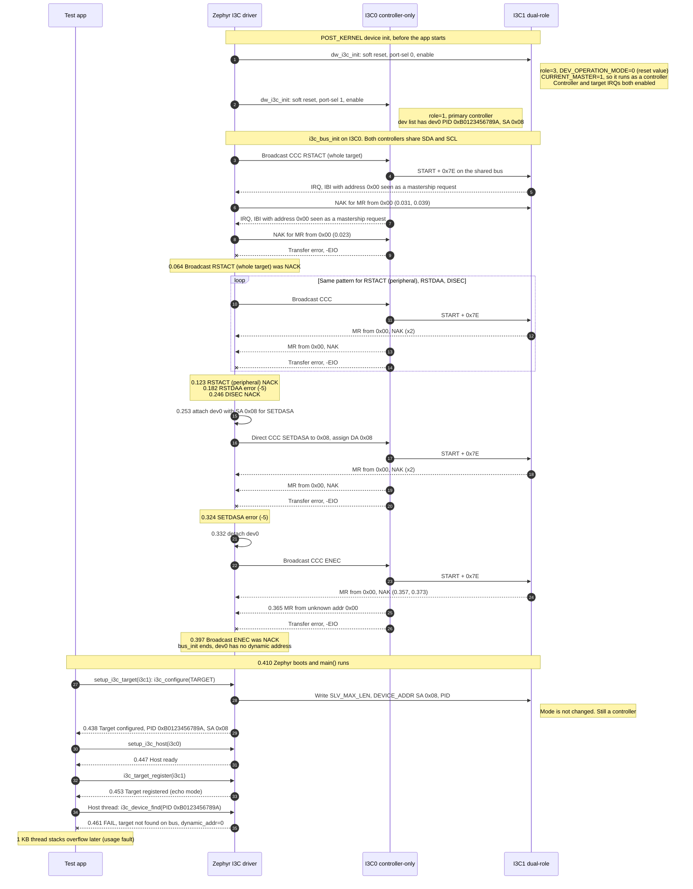

# MEC175x MECC card: I3C loopback, original failure

- Board: `mec_assy6941/mec1753_qsz`
- Source log: `teraterm_loopback.log` (no `bcr` property, 1 KB thread stacks)
- I3C0 = `i3c@40010800` (HOST0, controller-only), port-sel 1, GPIO012/GPIO013
- I3C1 = `i3c@40010000` (SEC0, dual-role), port-sel 0, GPIO132/GPIO140
- I3C0 and I3C1 pads are blue-wired together (SDA-SDA, SCL-SCL)
- The I3C1 role and `DEV_OPERATION_MODE` come from the debug readout in `teraterm_loopback_v3.log`

