# MEC175x MECC card: I3C loopback, original failure (teraterm_loopback.log)

- Board: `mec_assy6941/mec1753_qsz`
- Source log: `teraterm_loopback.log` only. Build without `bcr`, without the role readout,
  1 KB thread stacks.
- I3C0 = `i3c@40010800` (HOST0, controller-only), regs 0x40010800-0x40010FFF, port-sel 1
  at `HOST_CFG` 0x40010B00, GPIO012/GPIO013
- I3C1 = `i3c@40010000` (SEC0, dual-role), regs 0x40010000-0x400107FF, port-sel 0 written at
  0x40010300; its `SEC_CFG` at 0x40010400 is not written by this build. GPIO132/GPIO140
- I3C0 and I3C1 pads are blue-wired together (SDA-SDA, SCL-SCL)
- This log has no init readout. That I3C1 runs as a controller follows from
  `dw_i3c_handle_mr` on `i3c@40010000`: mastership requests are handled only on the
  controller IBI path. The register readout is in the `teraterm_loopback_v2.log` diagram.
- Orange blocks: bus exchange per CCC, inferred from the log (confirm with the analyzer).
  Red blocks inside: I3C1 driving the bus. I3C1 queues no transfer of its own (empty device
  list, so no bus init), but as an enabled controller it answers every I3C0 START by driving
  NACK and controller clocking. I3C0 sees that as a request from 0x00 and refuses it, and I3C1
  answers again: two I3C1 drive attempts and one I3C0 refusal per CCC.
- Log lines follow the bus exchange in ISR order. With immediate logging each line takes
  about 8 ms, while the bus exchange lasts microseconds, so log order is not bus order.

```mermaid
%%{init: {"theme": "base", "themeVariables": {"background": "#ffffff", "fontSize": "14px", "primaryColor": "#ffffff", "primaryTextColor": "#000000", "primaryBorderColor": "#000000", "textColor": "#000000", "lineColor": "#000000", "actorBkg": "#ffffff", "actorBorder": "#000000", "actorTextColor": "#000000", "actorLineColor": "#000000", "signalColor": "#000000", "signalTextColor": "#000000", "labelBoxBkgColor": "#ffffff", "labelBoxBorderColor": "#000000", "labelTextColor": "#000000", "loopTextColor": "#000000", "noteBkgColor": "#fff5ad", "noteBorderColor": "#000000", "noteTextColor": "#000000", "sequenceNumberColor": "#ffffff"}}}%%
sequenceDiagram
    autonumber
    participant APP as Test app
    participant DRV as Zephyr I3C driver
    participant I3C0 as I3C0 controller-only
    participant I3C1 as I3C1 dual-role
    rect rgb(255, 255, 255)

        %% I3C0: i3c@40010800 (HOST0, controller-only), regs 0x40010800-0x40010FFF
        %%       port-sel 1 written to HOST_CFG 0x40010B00 (base + 0x300), pads GPIO012/GPIO013
        %% I3C1: i3c@40010000 (SEC0, dual-role), regs 0x40010000-0x400107FF
        %%       port-sel 0 written to 0x40010300 (base + 0x300, a DCT entry on SEC0)
        %%       SEC_CFG at 0x40010400 (base + 0x400) is not written by this build, pads GPIO132/GPIO140
        %% I3C0 and I3C1 pads blue-wired together (SDA-SDA, SCL-SCL)

        Note over I3C0: Regs 0x40010800-0x40010FFF<br/>port-sel 1 at HOST_CFG 0x40010B00
        Note over I3C1: Regs 0x40010000-0x400107FF<br/>port-sel 0 at 0x40010300<br/>SEC_CFG 0x40010400 not written

        Note over DRV,I3C1: POST_KERNEL device init, before the app starts (not logged)
        rect rgb(255, 210, 210)
            DRV->>I3C1: dw_i3c_init: soft reset, port-sel 0, no mode write, enable
            Note right of I3C1: DEV_OPERATION_MODE keeps its reset value<br/>I3C1 dual-role runs as CONTROLLER<br/>First evidence in this log: 0.031 MR handled on i3c@40010000
        end
        Note right of I3C1: No bus init on I3C1 (empty device list)
        DRV->>I3C0: dw_i3c_init: soft reset, port-sel 1, enable
        Note right of I3C0: Primary controller<br/>dev list has dev0 PID 0xB0123456789A, SA 0x08

        Note over DRV,I3C1: i3c_bus_init on I3C0. Both instances act as controllers on SDA and SCL
        DRV->>I3C0: Broadcast CCC RSTACT (whole target)
        rect rgb(255, 230, 190)
            Note over I3C0,I3C1: Bus exchange, microseconds (inferred)
            I3C0->>I3C1: START + 0x7E header
            rect rgb(255, 190, 190)
                I3C1->>I3C0: I3C1 attempt 1: takes the START as an IBI, drives NACK and clocking
            end
            I3C0->>I3C1: I3C0 sees I3C1 driving as a request from 0x00, drives NACK
            rect rgb(255, 190, 190)
                I3C1->>I3C0: I3C1 attempt 2: sees that as another request, drives NACK and clocking
            end
        end
        Note over DRV,I3C1: Logged in ISR order
        I3C0-->>DRV: 0.023 i3c@40010800: NAK for MR from 0x00
        I3C1-->>DRV: 0.031 i3c@40010000: NAK for MR from 0x00
        I3C1-->>DRV: 0.039 i3c@40010000: NAK for MR from 0x00
        I3C0 --x DRV: Transfer error, -EIO
        Note over DRV: 0.064 Broadcast RSTACT (whole target) was NACK

        DRV->>I3C0: Broadcast CCC RSTACT (peripheral)
        rect rgb(255, 230, 190)
            Note over I3C0,I3C1: Bus exchange, microseconds (inferred)
            I3C0->>I3C1: START + 0x7E header
            rect rgb(255, 190, 190)
                I3C1->>I3C0: I3C1 attempt 1: takes the START as an IBI, drives NACK and clocking
            end
            I3C0->>I3C1: I3C0 sees I3C1 driving as a request from 0x00, drives NACK
            rect rgb(255, 190, 190)
                I3C1->>I3C0: I3C1 attempt 2: sees that as another request, drives NACK and clocking
            end
        end
        Note over DRV,I3C1: Logged in ISR order
        I3C1-->>DRV: 0.082 i3c@40010000: NAK for MR from 0x00
        I3C0-->>DRV: 0.090 i3c@40010800: NAK for MR from 0x00
        I3C1-->>DRV: 0.098 i3c@40010000: NAK for MR from 0x00
        I3C0 --x DRV: Transfer error, -EIO
        Note over DRV: 0.123 Broadcast RSTACT (peripheral) was NACK

        DRV->>I3C0: Broadcast CCC RSTDAA
        rect rgb(255, 230, 190)
            Note over I3C0,I3C1: Bus exchange, microseconds (inferred)
            I3C0->>I3C1: START + 0x7E header
            rect rgb(255, 190, 190)
                I3C1->>I3C0: I3C1 attempt 1: takes the START as an IBI, drives NACK and clocking
            end
            I3C0->>I3C1: I3C0 sees I3C1 driving as a request from 0x00, drives NACK
            rect rgb(255, 190, 190)
                I3C1->>I3C0: I3C1 attempt 2: sees that as another request, drives NACK and clocking
            end
        end
        Note over DRV,I3C1: Logged in ISR order
        I3C1-->>DRV: 0.141 i3c@40010000: NAK for MR from 0x00
        I3C0-->>DRV: 0.149 i3c@40010800: NAK for MR from 0x00
        I3C1-->>DRV: 0.157 i3c@40010000: NAK for MR from 0x00
        I3C0 --x DRV: Transfer error, -EIO
        Note over DRV: 0.182 RSTDAA error (-5)<br/>0.188 Broadcast RSTDAA was NACK

        DRV->>I3C0: Broadcast CCC DISEC
        rect rgb(255, 230, 190)
            Note over I3C0,I3C1: Bus exchange, microseconds (inferred)
            I3C0->>I3C1: START + 0x7E header
            rect rgb(255, 190, 190)
                I3C1->>I3C0: I3C1 attempt 1: takes the START as an IBI, drives NACK and clocking
            end
            I3C0->>I3C1: I3C0 sees I3C1 driving as a request from 0x00, drives NACK
            rect rgb(255, 190, 190)
                I3C1->>I3C0: I3C1 attempt 2: sees that as another request, drives NACK and clocking
            end
        end
        Note over DRV,I3C1: Logged in ISR order
        I3C1-->>DRV: 0.205 i3c@40010000: NAK for MR from 0x00
        I3C0-->>DRV: 0.213 i3c@40010800: NAK for MR from 0x00
        I3C1-->>DRV: 0.221 i3c@40010000: NAK for MR from 0x00
        I3C0 --x DRV: Transfer error, -EIO
        Note over DRV: 0.246 Broadcast DISEC was NACK

        DRV->>DRV: 0.253 attach dev0 with SA 0x08 for SETDASA
        DRV->>I3C0: Direct CCC SETDASA to SA 0x08, DA 0x08
        rect rgb(255, 230, 190)
            Note over I3C0,I3C1: Bus exchange, microseconds (inferred)
            I3C0->>I3C1: START + 0x7E header
            rect rgb(255, 190, 190)
                I3C1->>I3C0: I3C1 attempt 1: takes the START as an IBI, drives NACK and clocking
            end
            I3C0->>I3C1: I3C0 sees I3C1 driving as a request from 0x00, drives NACK
            rect rgb(255, 190, 190)
                I3C1->>I3C0: I3C1 attempt 2: sees that as another request, drives NACK and clocking
            end
        end
        Note over DRV,I3C1: Logged in ISR order
        I3C1-->>DRV: 0.282 i3c@40010000: NAK for MR from 0x00
        I3C0-->>DRV: 0.290 i3c@40010800: NAK for MR from 0x00
        I3C1-->>DRV: 0.299 i3c@40010000: NAK for MR from 0x00
        I3C0 --x DRV: Transfer error, -EIO
        Note over DRV: 0.324 SETDASA error (-5)<br/>0.341 SETDASA error on address 0x8 (-5)
        DRV->>DRV: 0.332 detach dev0

        DRV->>I3C0: Broadcast CCC ENEC
        rect rgb(255, 230, 190)
            Note over I3C0,I3C1: Bus exchange, microseconds (inferred)
            I3C0->>I3C1: START + 0x7E header
            rect rgb(255, 190, 190)
                I3C1->>I3C0: I3C1 attempt 1: takes the START as an IBI, drives NACK and clocking
            end
            I3C0->>I3C1: I3C0 sees I3C1 driving as a request from 0x00, drives NACK
            rect rgb(255, 190, 190)
                I3C1->>I3C0: I3C1 attempt 2: sees that as another request, drives NACK and clocking
            end
        end
        Note over DRV,I3C1: Logged in ISR order
        I3C1-->>DRV: 0.357 i3c@40010000: NAK for MR from 0x00
        I3C0-->>DRV: 0.365 i3c@40010800: MR from unknown addr 0x00
        I3C1-->>DRV: 0.373 i3c@40010000: NAK for MR from 0x00
        I3C0 --x DRV: Transfer error, -EIO
        Note over DRV: 0.397 Broadcast ENEC was NACK
        Note over DRV: bus_init ends, dev0 has no dynamic address

        Note over APP,I3C1: 0.410 Zephyr boots and main() runs
        APP->>DRV: setup_i3c_target(i3c1): i3c_configure(TARGET)
        DRV->>I3C1: SLV_MAX_LEN, DEVICE_ADDR SA 0x08, PID. Mode not changed
        DRV-->>APP: 0.438 Target configured, PID 0xB0123456789A, SA 0x08
        APP->>DRV: setup_i3c_host(i3c0)
        DRV-->>APP: 0.447 Host ready
        APP->>DRV: i3c_target_register(i3c1)
        DRV-->>APP: 0.453 Target registered (echo mode)
        APP->>DRV: Host thread: i3c_device_find(PID 0xB0123456789A)
        DRV --x APP: 0.461 FAIL, target not found on bus, dynamic_addr=0
        Note over APP: Log ends here
    end
```

